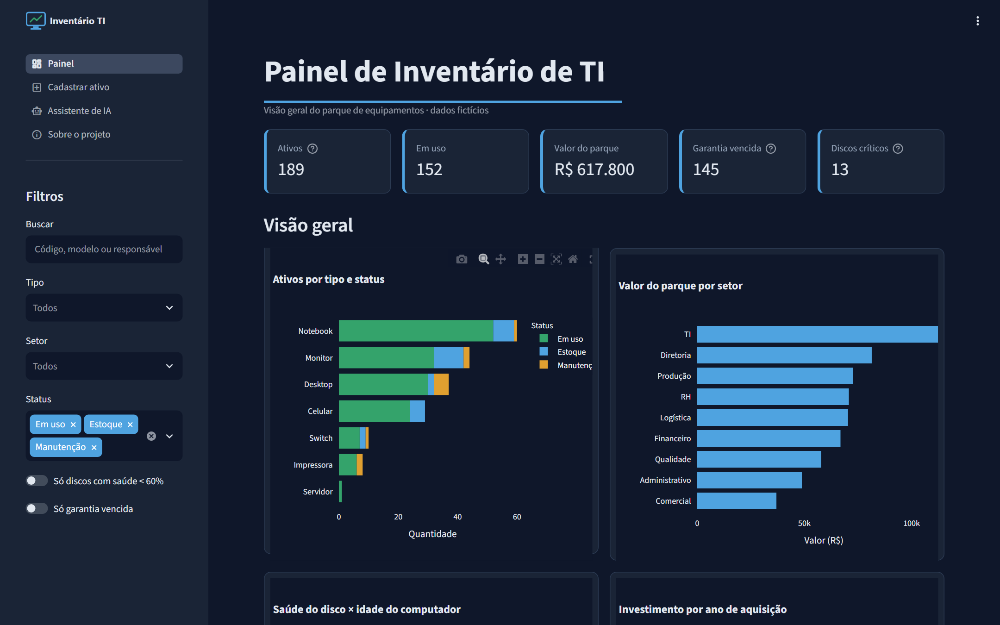
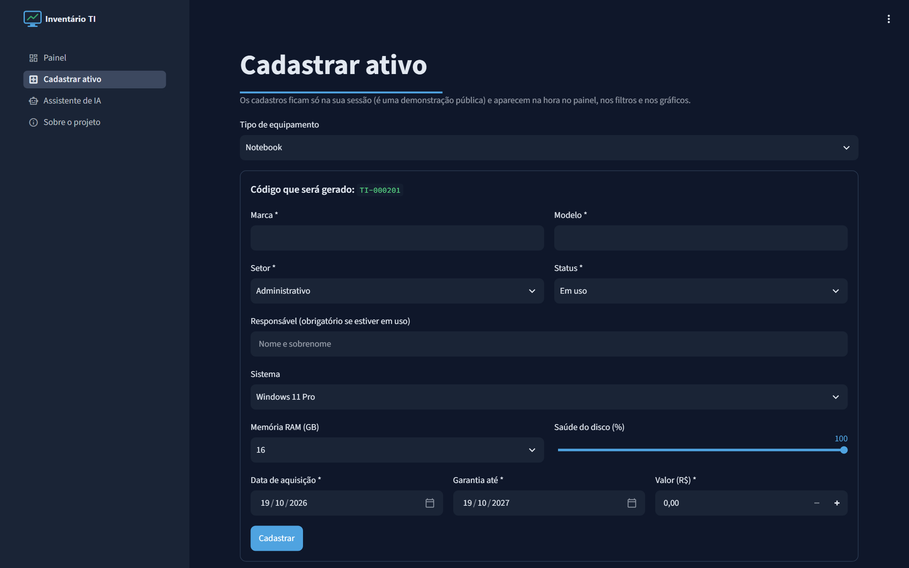

# 🖥️ Painel de Inventário de TI com Assistente de IA

Este é um app web feito em **Python + Streamlit** para controlar o parque de equipamentos de TI de uma empresa. Ele tem um painel com indicadores e gráficos interativos, um cadastro de ativos com validação e um **assistente de IA (Google Gemini)** que responde perguntas em linguagem natural consultando os dados por *function calling*.

O projeto é inspirado em um sistema real de inventário que desenvolvi para uma empresa do agronegócio. **Todos os dados aqui são fictícios**: são 200 ativos gerados pelo script `gerar_dados.py`.



## Funcionalidades

- **Painel:** KPIs (ativos, em uso, valor do parque, garantias vencidas, discos críticos), 4 gráficos interativos em Plotly e uma tabela formatada com barras de progresso, moeda e datas.
- **Filtros:** busca livre e filtros por tipo, setor e status, além de atalhos para "discos críticos" e "garantia vencida". O resultado filtrado pode ser exportado em CSV.
- **Cadastro de ativo:** formulário com validação. O ativo cadastrado aparece na hora no painel, graças ao Session State.
- **Assistente de IA:** você pergunta, por exemplo, *"Quantos notebooks têm mais de 5 anos?"*, e o Gemini decide qual função Python chamar. Quem faz a conta exata é o pandas, e o modelo só redige a resposta. Assim **a IA não inventa números**, e o app mostra quais funções foram usadas em cada resposta.



## Conceitos de Streamlit aplicados

| Conceito | Onde |
|---|---|
| App multipágina (`st.navigation`, `st.Page`) | `app.py` |
| Session State | `comum.py`, `paginas/cadastro.py` |
| Cache (`st.cache_data`) | `comum.py` |
| Formulários com validação (`st.form`) | `paginas/cadastro.py` |
| `column_config` (progresso, moeda, datas) | `paginas/painel.py` |
| Tema + CSS customizado | `.streamlit/config.toml`, `estilo/estilo.css` |
| Chat e *function calling* com LLM | `paginas/assistente.py`, `ferramentas_ia.py` |

## Stack

`Python 3.12` · `Streamlit` · `pandas` · `Plotly Express` · `Google Gemini API (google-genai)`

## Como rodar

```bash
git clone https://github.com/PPena23/painel-inventario-ti-ia.git
cd painel-inventario-ti-ia
python -m venv .venv
.venv\Scripts\activate        # Linux/Mac: source .venv/bin/activate
pip install -r requirements.txt
python gerar_dados.py         # (opcional) gera uma nova base fictícia
streamlit run app.py
```

Para usar o assistente, gere uma chave gratuita em [aistudio.google.com](https://aistudio.google.com). Depois copie `.streamlit/secrets.toml.example` para `.streamlit/secrets.toml` e preencha a variável `GEMINI_API_KEY`.

## Estrutura

```
app.py               # ponto de entrada: tema, CSS e navegação
comum.py             # constantes, Session State e leitura da base (cache)
ferramentas_ia.py    # funções que a IA pode chamar (function calling)
gerar_dados.py       # gera dados/ativos.csv fictício
paginas/             # painel, cadastro, assistente, sobre
estilo/              # CSS e logo
```

---

Feito por **Pedro Pena**: [LinkedIn](https://www.linkedin.com/in/pedropena23/) · [GitHub](https://github.com/PPena23)
